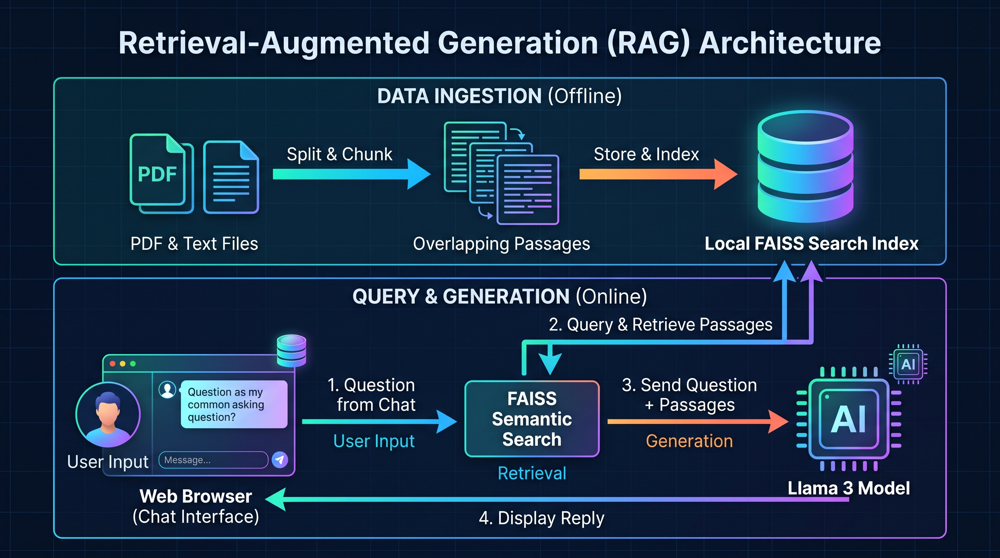

# Medical RAG Chatbot

Ask a question in the browser, and the chatbot searches your medical reference files for a relevant passage. It sends the question and that passage to a language model on Hugging Face, then displays the reply in the chat. This search-then-answer process is called **retrieval-augmented generation (RAG)**.

## How it works



**When the documents change**, the indexer splits them into short, overlapping passages so text near a boundary can appear in both. An embedding model turns each passage into a list of numbers that represents its meaning. FAISS stores these locally for reuse.

**When someone asks a question**, the app uses the same embedding model to look up one passage by meaning. The prompt asks Llama 3 to answer in two or three lines using that passage. Flask keeps the exchange in the chat session.

## Where to look in the code

| If you want to understand… | Start here |
| --- | --- |
| What happens when you press **Send Message** | [Flask request handler](app/application.py) |
| How files become searchable passages | [Document loader and text splitter](app/components/pdf_loader.py) · [Embedding model](app/components/embeddings.py) |
| Where the search index is saved and loaded | [FAISS vector store](app/components/vector_store.py) |
| What the model receives for each question | [Retriever and answer prompt](app/components/retriever.py) · [Hugging Face connection](app/components/llm.py) |

## Run locally

1. From the project root, use a Python 3.10 virtual environment and install the dependencies.

   ```sh
   python -m pip install flask python-dotenv streamlit faiss-cpu pypdf sentence-transformers "langchain==0.2.0" "langchain-community==0.2.0" "langchain-huggingface==0.0.3" "langchain-openai==0.1.7"
   ```

2. Set `HF_TOKEN` to a Hugging Face token with inference access. The app reads it from Streamlit secrets or the environment.
3. Place your reference files (`.pdf` or `.txt`) in `data/`. Build the index and start the app.

   ```sh
   python -m app.components.data_loader
   python -m app.application
   ```

4. Open [the local chat page](http://127.0.0.1:5000) and ask a question about your documents.

Run the data loader again after adding or changing reference files.
